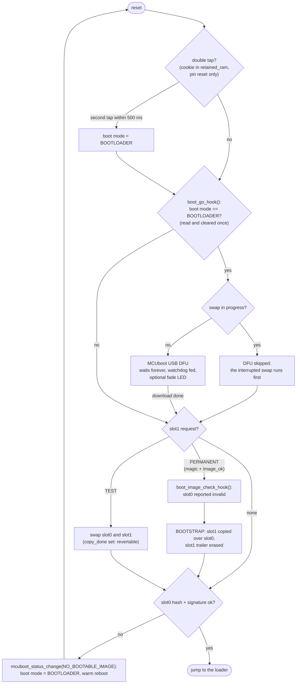
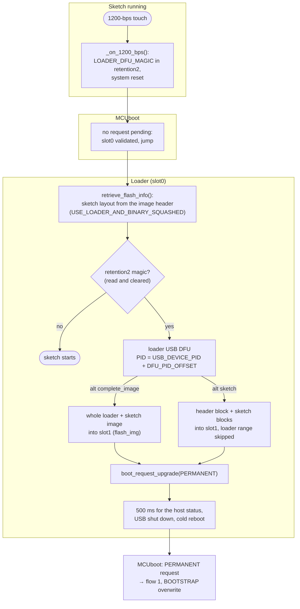
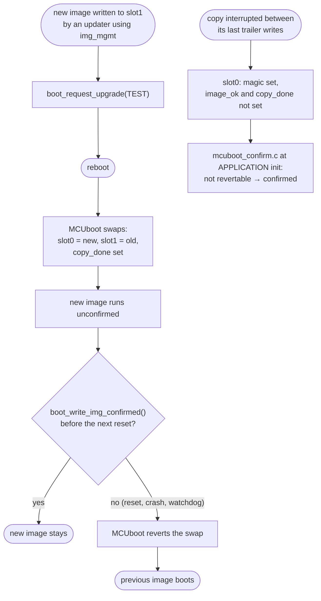

# MCUboot update flows

How a board that boots the loader through MCUboot gets a new image, and which component decides
what at each step. It covers the loader USB DFU (`loader/dfu_flash_updates.c`), the MCUboot hooks
built into MCUboot from `loader/mcuboot_hooks/`, and the loader-side confirm
(`loader/mcuboot_confirm.c`).

The hooks assume a swap mode (`swap-using-offset`, `swap-using-move` or `swap-scratch`) with
`CONFIG_BOOT_BOOTSTRAP`. Each variant enables them in its `mcuboot.conf`:

| Option (MCUboot image) | Effect |
|---|---|
| `CONFIG_BOOT_IMAGE_ACCESS_HOOKS` | permanent requests overwrite slot0, test requests are swapped |
| `CONFIG_ARDUINO_MCUBOOT_DFU_BOOT_MODE` | the retention boot mode `BOOT_MODE_TYPE_BOOTLOADER` opens MCUboot's USB DFU, without a timeout |
| `CONFIG_ARDUINO_MCUBOOT_DOUBLE_TAP` | a second reset-button press within 500 ms sets that boot mode |
| `CONFIG_ARDUINO_MCUBOOT_DFU_FADE_LED` | fades the `mcuboot-fade-led0` LED while MCUboot waits in USB DFU |

## Entry points

| Trigger | Sets | Ends up in |
|---|---|---|
| 1200-bps touch on the sketch's serial port | `CONFIG_LOADER_DFU_MAGIC` at offset 0 of `retention2` | loader USB DFU (`CONFIG_USE_DFU_FLASH_UPDATES`) |
| Double tap of the reset button | boot mode `BOOTLOADER` | MCUboot USB DFU |
| No bootable image in slot0 | boot mode `BOOTLOADER`, warm reboot | MCUboot USB DFU |
| Sketch header not valid (`CONFIG_WAIT_FOR_DFU_IF_SKETCH_IS_NOT_VALID`) | — | loader USB DFU |

Software and watchdog resets never open the double-tap window: only a reset-pin reset does.

## 1. Boot decision (every reset)

A permanent request never leaves a backup: the old image is overwritten, so a bad download is
caught by the signature check and ends in MCUboot USB DFU, not in a revert.

## 2. USB upload through the loader DFU

- `complete_image` carries the loader and the sketch: use it whenever the loader changes.
- `sketch` rewrites only the blocks after the loader. The image hash still covers the loader
  range, which is taken from what slot1 already holds: if slot1 does not hold the same loader
  (first upload after flashing with a probe, after a swap, after a loader change), MCUboot
  rejects the image and the previous one keeps running.

## 3. Test requests and the confirm

- The series itself only issues permanent requests (USB DFU). A test request comes from an updater
  that writes slot1 and requests a test upgrade, for example an MCUboot-based OTA.
- `mcuboot_confirm.c` confirms only images MCUboot cannot revert (`copy_done` not set); a real test
  image stays unconfirmed until the application confirms it.
